  <a href="https://k11e3r.github.io/"><b>Portfolio</b></a> &nbsp;·&nbsp;
  <a href="https://neurvexia.com"><b>Neurvexia</b></a> &nbsp;·&nbsp;
  <a href="https://www.linkedin.com/in/yassine-naanani-5332a7a0/"><b>LinkedIn</b></a> &nbsp;·&nbsp;
  <a href="mailto:contact@neurvexia.com"><b>contact@neurvexia.com</b></a>

## About

I'm an AI engineer and full-stack developer based in Alençon, France. I build retrieval-augmented systems, autonomous agents and automation, and I ship them with production-grade engineering across backend, data and ERP.

Through my company [Neurvexia](https://neurvexia.com), I help small, medium and large companies across Europe and Africa run their operations on one connected system, from CRM and stock to a warehouse modelled live in 3D.

## Selected work

| Project | What it is | Links |
| --- | --- | --- |
| **GhostKit** | Modular security-analysis framework for authorized testing: web scanners, AI-assisted triage, structured reports. | [Site](https://k11e3r.github.io/GhostKit/) |
| **PO Translator** | Desktop tool that translates Odoo `.po` files with Gemini, or offline with built-in glossaries. | [Code](https://github.com/K11E3R/odoo_translator) · [Tutorial](https://k11e3r.github.io/odoo_translator/) |
| **Moroccan Education API** | Open API for Morocco's national curriculum: levels, subjects and course content in Arabic and French. | [Code](https://github.com/K11E3R/moroccan-education-API) · [Live](https://moroccan-education-api.up.railway.app/) |
| **EchoPad** | Discord productivity bot: notes, polls, tasks, events and reminders across 36 slash commands. | [Discord](https://discord.com/discovery/applications/1205159587645362207/store) |
| **AtlasPulse** | AI and IT news from eight live sources, matched to the reader's level, with a story agent. | [Live](https://atlas-pulse.netlify.app) |
| **NASA Space Apps 2024** | Signal processing and machine learning to detect seismic events in planetary data. | [Code](https://github.com/K11E3R/Nasa-Space-Apps-Challenge) |

More on the [work page](https://k11e3r.github.io/projects.html).

## Stack

## Currently building

- **Autonomous developer agents** — error triage and auto-resolution wired into CI/CD.
- **LLM observability** — real-time monitoring built on vector embeddings.
- **Odoo analytics** — one dashboard across ERP data, GitHub workflows and internal metrics.
- **AI security tooling** — vulnerability assessment with AI-assisted triage.

## Contact

Tell me what you run today and what is getting in the way. I answer by email at [contact@neurvexia.com](mailto:contact@neurvexia.com), or you can [book a call](https://neurvexia.com/book) through Neurvexia.

